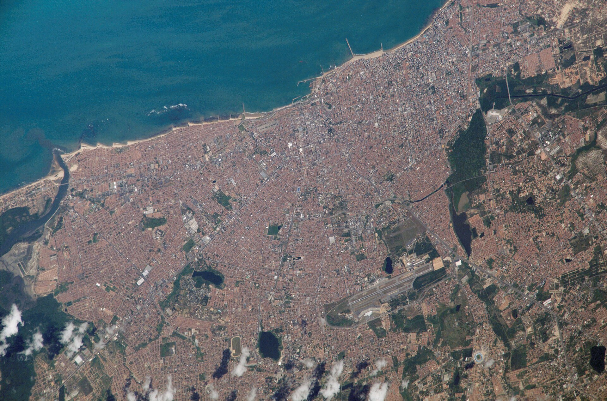
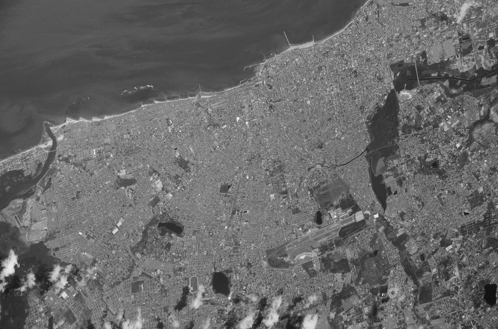
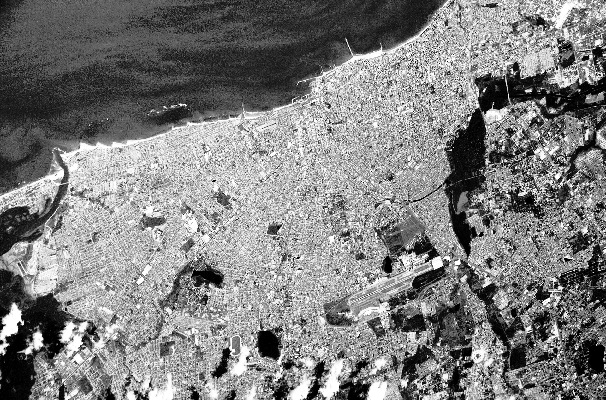
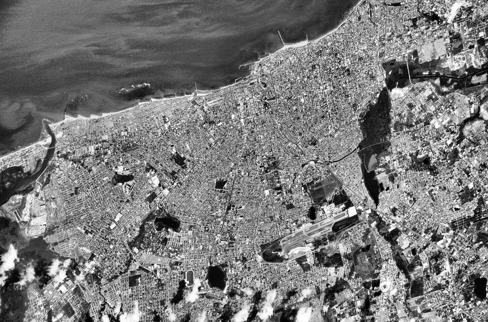
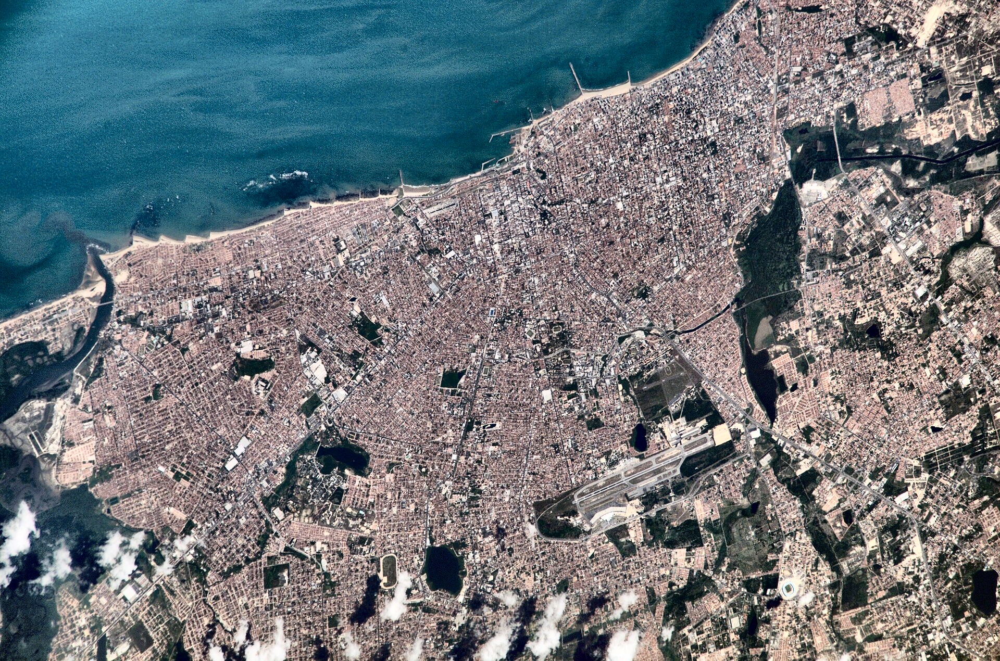
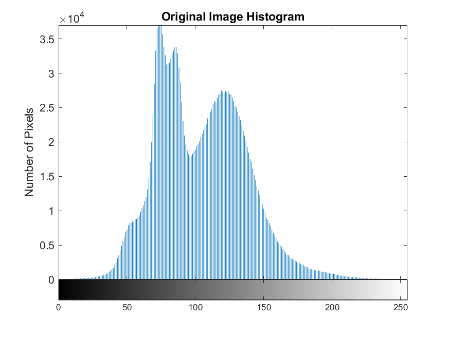
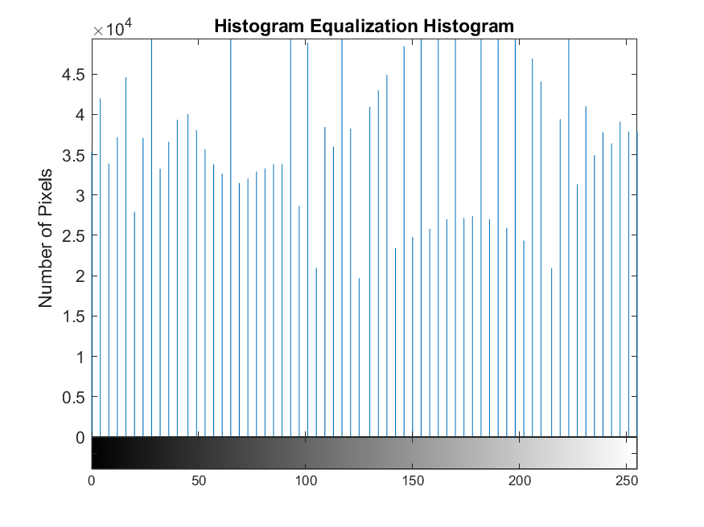
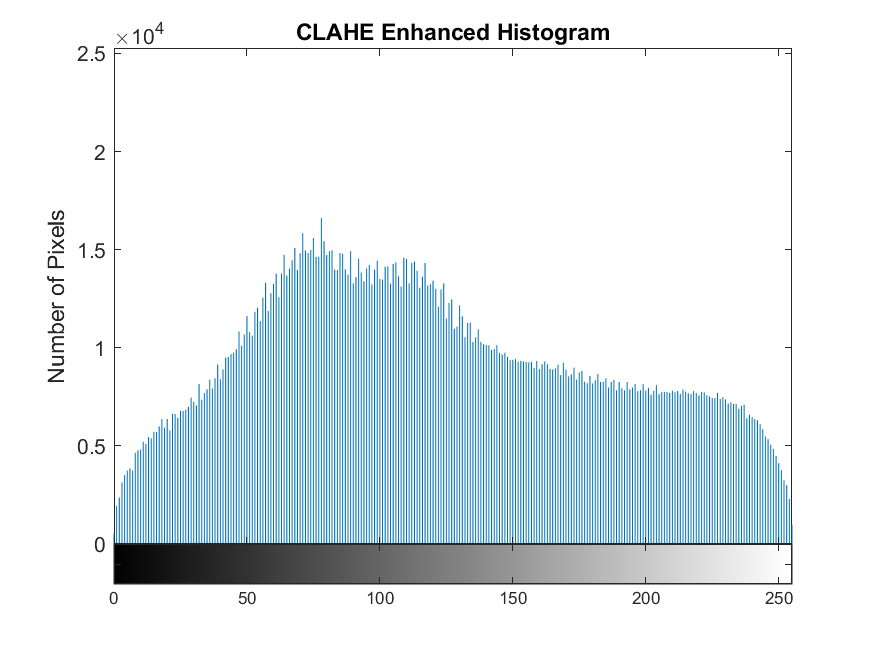

# 🛰️ Satellite Image Enhancement Using Histogram Equalization and CLAHE

A MATLAB-based Digital Image Processing project that enhances satellite images using **Histogram Equalization (HE)** and **Contrast Limited Adaptive Histogram Equalization (CLAHE)**. It also implements color-preserving CLAHE using the **LAB color space** to improve image visibility while retaining original color information.

---

## 📌 1. Project Overview

Satellite images are widely used in agriculture, urban planning, environmental monitoring, disaster management, and geographical analysis. However, low contrast and uneven brightness can make important geographical features difficult to identify.

This project implements classical image enhancement techniques in MATLAB to improve the visual quality and visibility of satellite images.

The project includes:
- Global contrast enhancement using Histogram Equalization.
- Local contrast enhancement using CLAHE.
- Color-preserving enhancement using LAB color space.
- Histogram visualization and comparison.
- Quantitative evaluation using contrast and entropy.
- Automatic saving of processed images and histograms.

---

## 🎯 2. Project Objectives

- Improve the overall contrast of satellite images.
- Enhance local image details using CLAHE.
- Preserve original color information during enhancement.
- Compare Histogram Equalization and CLAHE results.
- Evaluate image enhancement using contrast and entropy.
- Automatically save all output images and histograms.

---

## ⚙️ 3. Enhancement Techniques

### 3.1 Histogram Equalization (HE)

Histogram Equalization is a global contrast enhancement technique. It redistributes image intensity values using the cumulative distribution function (CDF) to improve overall image contrast.

**MATLAB Function:**
```matlab
HE = histeq(G);
```

### 3.2 Contrast Limited Adaptive Histogram Equalization (CLAHE)

CLAHE improves local contrast by dividing an image into smaller regions called tiles and applying histogram equalization independently to each region.

A clipping limit controls excessive contrast amplification and helps prevent over-enhancement.

**Parameters used:**

| Parameter | Value |
|---|---|
| NumTiles | [8 8] |
| ClipLimit | 0.01 |
| Distribution | uniform |

**MATLAB Function:**
```matlab
CLAHE = adapthisteq(G, ...
    'NumTiles', [8 8], ...
    'ClipLimit', 0.01, ...
    'Distribution', 'uniform');
```

### 3.3 Color-Preserving CLAHE Using LAB Color Space

To retain the original color information, the RGB satellite image is converted into LAB color space.

LAB consists of three channels:

- **L:** Lightness or brightness information.
- **A:** Green-to-red color information.
- **B:** Blue-to-yellow color information.

CLAHE is applied only to the L channel, while the original A and B channels are retained.

The enhanced image is then converted back to RGB.

**Processing Flow:**

`RGB → LAB → Extract L Channel → Apply CLAHE → Combine A and B → LAB to RGB`

This method improves luminance contrast while preserving the original color information.

---

## 🖼️ 4. Project Results

The following images show the outputs generated by the MATLAB program.

### 4.1 Original Satellite Image



### 4.2 Grayscale Satellite Image



### 4.3 Histogram Equalization Result



### 4.4 Grayscale CLAHE Result



### 4.5 Color-Preserving CLAHE Result



---

## 📊 5. Histogram Analysis

Histograms represent the distribution of pixel intensity values in an image. They help analyze how the intensity distribution changes after enhancement.

### Original Image Histogram



### Histogram Equalization Histogram



### CLAHE Enhanced Histogram



---

## 📈 6. Performance Evaluation

The project uses two parameters to evaluate image enhancement.

| Parameter | MATLAB Function | Description |
|---|---|---|
| Contrast | `std2()` | Measures the standard deviation of image intensity values. |
| Entropy | `entropy()` | Measures the information content of the image intensity distribution. |

These parameters are calculated for:
- Original grayscale image.
- Histogram Equalization result.
- Grayscale CLAHE result.

**Note:** Higher contrast or entropy does not always indicate better visual quality. Numerical measurements should be considered along with visual inspection.

The current implementation does not calculate these measurements for the color CLAHE output.

---

## 💻 7. Software Requirements

| Component | Requirement |
|---|---|
| Programming Language | MATLAB |
| Software | MATLAB |
| Toolbox | Image Processing Toolbox |
| Input | RGB or Grayscale Satellite Image |
| Supported Formats | JPG, JPEG, PNG, TIF, BMP |

---

## 🚀 8. How to Run the Project

1. Clone or download this repository.
2. Open MATLAB.
3. Open the project `.m` file.
4. Run the MATLAB script.
5. Select an RGB or grayscale satellite image using the file selection window.
6. View the original and enhanced images along with their histograms.
7. Check the MATLAB Command Window for contrast and entropy values.
8. Find the generated results in the automatically created output folder.

---

## 📁 9. Output Files

The MATLAB program generates the following files:

| Filename | Description |
|---|---|
| `01_Original_Image.png` | Original satellite image |
| `02_Grayscale_Image.png` | Grayscale satellite image |
| `03_Histogram_Equalization.png` | Histogram Equalization output |
| `04_Grayscale_CLAHE.png` | Grayscale CLAHE output |
| `05_Color_CLAHE_Enhanced.png` | Color-preserving CLAHE output |
| `06_Original_Histogram.png` | Original image histogram |
| `07_HE_Histogram.png` | Histogram Equalization histogram |
| `08_CLAHE_Histogram.png` | CLAHE histogram |

A new output folder is created for every execution to prevent previous results from being overwritten.

Example:

```text
CLAHE_Results/
CLAHE_Results_1/
CLAHE_Results_2/
```

---

## 📂 10. Repository Structure

For all result images to appear correctly on GitHub, maintain the following structure:

```text
Satellite-Image-Enhancement/
│
├── README.md
├── Satellite_Image_Enhancement.m
│
├── 01_Original_Image.png
├── 02_Grayscale_Image.png
├── 03_Histogram_Equalization.png
├── 04_Grayscale_CLAHE.png
├── 05_Color_CLAHE_Enhanced.png
│
├── 06_Original_Histogram.png
├── 07_HE_Histogram.png
└── 08_CLAHE_Histogram.png
```

**Important:** The image filenames and locations must match the relative paths used in this README.

If you store the images inside a separate folder, update the image paths accordingly.

---

## ⚠️ 11. Limitations

- Enhancement quality depends on the input satellite image.
- Histogram Equalization may sometimes produce excessive global contrast.
- CLAHE can amplify noise in certain image regions.
- Selected CLAHE parameters may not be optimal for every image.
- Contrast and entropy alone cannot completely represent perceived image quality.
- Image enhancement cannot recover geographical information that is absent from the original image.

---

## 🔮 12. Future Scope

- Automatic selection of CLAHE parameters.
- Comparison with other enhancement techniques such as Gamma Correction and Retinex.
- Integration of noise reduction techniques.
- Implementation of additional image quality evaluation parameters.
- Development of a MATLAB GUI for easier operation.
- Extension to batch processing of multiple satellite images.

---

## 👨‍💻 13. Author

**Kartik Agrawal**  
B.Tech – Electronics and Communication Engineering  
Indian Institute of Information Technology, Nagpur

---

## 📚 14. References

1. Rafael C. Gonzalez and Richard E. Woods, *Digital Image Processing*, 4th Edition.
2. K. Zuiderveld, "Contrast Limited Adaptive Histogram Equalization," *Graphics Gems IV*, 1994.
3. MATLAB Documentation – `histeq()`.
4. MATLAB Documentation – `adapthisteq()`.
5. MATLAB Documentation – `rgb2lab()` and `lab2rgb()`.

---

**Project Domain:** Digital Image Processing | Satellite Image Enhancement | MATLAB
